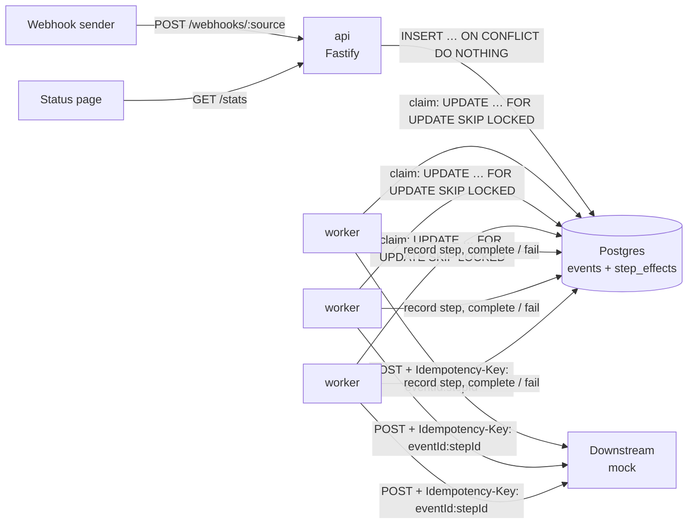

# Tripwire

**Event-driven Automation with Proven Reliability**

Tripwire is an event-triggered automation engine. It receives webhooks and runs multi-step YAML workflows in response. Postgres is its only datastore, and also its queue.

It makes two guarantees:

1. **No lost events.** Every unique event ends in `succeeded` or `dead`.
2. **No duplicate side effects.** Each (event, step) effect happens once downstream, even with duplicate deliveries, worker crashes and retries.

These aren't just claims. A **chaos harness** attacks the running system with duplicate webhooks, lost responses, poison events and `docker kill`ed workers, then verifies both guarantees against independent evidence. A **control run** turns off deduplication and shows that the harness catches the duplicates. See [TEST_REPORT.md](TEST_REPORT.md) for the latest real results.

---

## Contents

- [Quick start](#quick-start)
- [Architecture](#architecture)
- [How the guarantees are kept](#how-the-guarantees-are-kept)
- [API](#api)
- [Workflows](#workflows)
- [Configuration](#configuration)
- [Failure scenarios](#failure-scenarios)
- [Chaos harness](#chaos-harness)
- [Testing](#testing)
- [2-minute demo](#2-minute-demo)
- [Deployment notes](#deployment-notes)
- [Project layout](#project-layout)
- [Limitations](#limitations)

---

## Quick start

**You need:**
- **Docker Desktop**, installed and running. It provides the Docker engine, CLI and Compose.
- **Node 22 or later**, only to run the chaos harness and the type check on your machine. Everything else runs in Docker.

```sh
git clone <this repo> tripwire && cd tripwire
npm ci                                   # host dependencies for the chaos harness and tsc
docker compose up -d --build             # db, api, worker, mock
curl localhost:3000/health               # {"ok":true}
```

Send an event, then look it up:

```sh
curl -s -X POST localhost:3000/webhooks/shop \
  -H 'content-type: application/json' -H 'x-event-id: order-1' \
  -d '{"type":"order.created","order":42}'
# {"id":"<uuid>","duplicate":false}

curl -s localhost:3000/events/<uuid>     # status, attempts, and the steps already done
```

Open **http://localhost:3000** for the live status page.

To stop everything, run `docker compose down`. Add `-v` to wipe the database as well.

---

## Architecture



| Service | Role |
|---|---|
| `db` | Postgres 16. Holds the event log and the job queue in one table. |
| `api` | Receives webhooks and deduplicates them on insert. Serves event lookup, the dead letter list, replay, stats and the status page. |
| `worker` | One process per container, scaled with `--scale worker=N`. Claims an event, runs its workflow, then marks the result. |
| `mock` | A fake downstream that applies each `Idempotency-Key` once. It can simulate lost responses, latency and poison events, and it counts every call. |
| `tests` | Runs the test suite against the real Postgres. Only started by `docker compose run --rm tests`. |

### Design decisions

| Decision | Why |
|---|---|
| **Postgres is both the event log and the queue** (`FOR UPDATE SKIP LOCKED`) | The event and its job state live in one row, so there is no dual-write gap between a log and a separate queue. `SKIP LOCKED` lets many workers claim at once without blocking each other or double-claiming. |
| **Lease (`locked_until`) instead of heartbeats** | A crashed worker needs no cleanup: its lease expires and the claim query picks the job up again. The cost is that recovery waits up to one lease length (30s by default). |
| **Step-level `Idempotency-Key: {eventId}:{stepId}`** | `step_effects` can't close the gap between "downstream call succeeded" and "we recorded it". A crash there causes a retry, and the key lets the downstream recognise it. Tripwire delivers at least once; a deduplicating downstream turns that into exactly once. |
| **`attempts` as a fencing token** | Every claim increments `attempts`. `complete` and `fail` only apply when `attempts` still matches, so a worker that stalled past its lease can't overwrite the run of the worker that reclaimed the event. |
| **One worker per container** | Killing a container is then exactly killing a worker, which is what the chaos harness does. There's no in-process concurrency to reason about. |
| **Schema applied on every start, under an advisory lock** | The API and every worker run `schema.sql` (`IF NOT EXISTS`) on start, so startup order doesn't matter. The lock stops concurrent `CREATE TABLE` statements from colliding on a fresh database. |

### Data model

```sql
events(id uuid PK, source, idem_key UNIQUE, type, payload jsonb,
       status ∈ queued|running|succeeded|dead, attempts, next_run_at,
       locked_until, last_error, created_at)
step_effects(event_id, step_id, done_at, PRIMARY KEY (event_id, step_id))
```

The full schema is in [`schema.sql`](schema.sql).

---

## How the guarantees are kept

**No lost events**
1. **Ingress:** an event is stored before the webhook gets its `202`. If the insert fails, the sender sees an error and retries.
2. **Claim:** a single atomic `UPDATE … WHERE id = (SELECT … FOR UPDATE SKIP LOCKED LIMIT 1) RETURNING *`. It marks the event `running`, increments `attempts` and sets a lease.
3. **Crash recovery:** if a worker dies, its lease expires and another worker reclaims the event. Nothing has to notice the crash.
4. **Failure:** a failed step requeues the event with exponential backoff and full jitter. After `max_attempts` it becomes `dead`, and it can be replayed.
5. **Completion:** an event is only marked `succeeded` after every step has finished.

**No duplicate side effects**
1. **Duplicate webhooks:** the `idem_key` is `X-Event-Id`, or the SHA-256 of the raw body when that header is missing. A `UNIQUE` constraint with `ON CONFLICT DO NOTHING` enforces it, never check-then-insert.
2. **Completed steps:** each finished step is recorded in `step_effects`, and a retry skips steps that are already recorded.
3. **The crash gap:** a crash after the downstream call but before the record causes a retry with the same `Idempotency-Key`, which the downstream deduplicates.

---

## API

| Method and path | Response |
|---|---|
| `POST /webhooks/:source` | `202 { id, duplicate }`. The body must be JSON with a non-empty `type`, and the whole body becomes the payload. The dedup key is the `X-Event-Id` header, or the SHA-256 of the raw body. Returns `400` on invalid JSON or a missing `type`. |
| `GET /events/:id` | `200` with the event row plus `steps: [{ step_id, done_at }]`, or `404`. |
| `GET /dead` | `200` with the list of `dead` events, oldest first. |
| `POST /dead/:id/replay` | `202 { id }`. Resets the event to `queued`, `attempts = 0`, due now. Completed steps stay recorded, so the replay resumes rather than starting over. Returns `404` if the event isn't dead. |
| `GET /stats` | `200 { counts, attempts, oldestQueuedMs, running }`: counts by status, an attempts histogram, the age of the oldest queued event, and the running events. |
| `GET /` | The live status page, which polls `/stats` every second. |
| `GET /health` | `200 { ok: true }` |

The mock downstream on port 4000:

| Method and path | Response |
|---|---|
| `POST /:name` | Applies an effect once per `Idempotency-Key`. Returns `400` without the header, and `500` for a body containing `"poison": true`. |
| `GET /stats` | `{ calls, applied }`: every raw call, and the applied count per key. |
| `POST /reset` | Clears the calls and counts. |
| `GET /health` | `{ ok: true }` |

---

## Workflows

Each file in `workflows/*.yaml` handles one event type:

```yaml
# workflows/order-created.yaml
on: order.created
max_attempts: 5
steps:
  - id: charge
    action: http.post
    url: http://mock:4000/charge
  - id: notify
    action: http.post
    url: http://mock:4000/notify
```

- **`on`:** the event `type` this workflow handles.
- **`max_attempts`:** how many attempts an event gets before it becomes `dead`.
- **`steps`:** run in order. Step `id`s must be unique within a workflow, because each one is part of the idempotency key.
- **`http.post`:** sends the event payload as JSON with `Idempotency-Key: {eventId}:{stepId}` and a 5s timeout. Any non-2xx response is a failure.
- **`log`:** prints the event and step as JSON.

Workflow files are validated with zod on worker start, and an invalid file stops the worker with an error naming the file. An event whose type has no workflow goes straight to `dead`.

---

## Configuration

All configuration is read from environment variables, in one place: `src/config.ts`.

| Variable | Default | Used by | Meaning |
|---|---|---|---|
| `DATABASE_URL` | (required) | all | Postgres connection string |
| `PORT` | `3000` | api, mock | HTTP port |
| `LEASE_MS` | `30000` | worker | How long a claim holds an event before another worker may reclaim it |
| `POLL_MS` | `500` | worker | Wait between claims when nothing is claimable |
| `WORKFLOWS_DIR` | `<repo>/workflows` | worker | Where the workflow YAML files are |
| `MOCK_FAIL_RATE` | `0` | mock | Fraction of responses to lose (a `500` after the effect is applied) |
| `MOCK_LATENCY_MS` | `0` | mock | Delay added to every call |
| `MOCK_DEDUPE` | `true` | mock | `false` turns off `Idempotency-Key` dedup, for the chaos control run |
| `CRASH_AFTER_STEP` | (unset) | worker | Test hook: exit after this step's downstream call, before it is recorded |

`docker-compose.yml` passes `MOCK_FAIL_RATE`, `MOCK_LATENCY_MS` and `MOCK_DEDUPE` through from your shell, for example `MOCK_FAIL_RATE=0.3 docker compose up -d`.

---

## Failure scenarios

| Fault | Behaviour | Covering test |
|---|---|---|
| The same webhook is delivered twice | One event; the second response has `duplicate: true` | `duplicate webhook with same X-Event-Id returns same id with duplicate true` |
| 20 identical webhooks arrive at once | Exactly one row | `20 concurrent duplicates via Promise.all create exactly one row` |
| Webhook without `X-Event-Id`, resent | Deduplicated by the SHA-256 of the body | `same body without X-Event-Id is deduped by body hash` |
| Many workers claim at the same moment | Each event goes to exactly one worker | `no double claim under concurrent claims` |
| A worker is `SIGKILL`ed mid-event | The lease expires, another worker reclaims the event, and it succeeds | `event not lost when a worker is killed while running` |
| A crash after the downstream call, before the record | The retry carries the same key, and the downstream applies the effect once | `crash after call but before record does not duplicate the effect` |
| A crash between steps | Resumes at the step that wasn't recorded | `crash mid-workflow resumes at the next step` |
| A worker stalls past its lease, then wakes | Its `complete` or `fail` is fenced out by `attempts` | `stale worker cannot complete after its lease is reclaimed` |
| The downstream returns 5xx or times out | Requeued with exponential backoff and jitter | `failed event is requeued with future next_run_at`, `http.post fails after 5s timeout` |
| The response is lost after the effect was applied | The retry is deduplicated by `Idempotency-Key` | `mock applies an effect once for repeated Idempotency-Key`, plus the chaos run |
| A poison event always fails | `dead` after `max_attempts`, listed in `/dead` | `event becomes dead after max_attempts` |
| A dead event is fixed and replayed | Runs again and skips completed steps | `replay of dead event runs again and succeeds` |
| A later step fails after an earlier one succeeded | The event is not marked `succeeded` | `event is not succeeded until all steps finish` |
| An invalid workflow file | The worker refuses to start, with the zod error | `invalid workflow file is rejected with a zod error` |
| All of the above at once, at scale | 0 lost, 0 duplicate effects | **chaos harness** (below) |

---

## Chaos harness

```sh
npx tsx chaos/run.ts --events 1000 --duplicates 3 --kills 5 --fail-rate 0.2 --poison 10
```

| Flag | Default | Meaning |
|---|---|---|
| `--events N` | 100 | Unique events to send |
| `--duplicates K` | 1 | Deliver each event a random 1 to K times. Deliveries are shuffled, with 20 in flight at once. |
| `--kills M` | 0 | `docker kill` a random worker M times at random intervals (0.5 to 2.5s), restarting it each time |
| `--fail-rate F` | 0 | Lose this fraction of downstream responses, replays included |
| `--poison P` | 0 | Extra events that always fail downstream |
| `--no-idempotency` | off | Control run: the downstream ignores `Idempotency-Key` |
| `--seed S` | random | Seeds the delivery order and kill schedule, so a failing run can be repeated |

**What it does**
1. Starts the stack with 3 workers.
2. Sends the load while killing workers.
3. Waits until each of its own events is `succeeded` or `dead`, with a 3-minute deadline. Anything still unfinished at the deadline counts as lost.
4. Writes `chaos/last-run.json`.
5. Runs the checker.

**`chaos/check.ts`** compares three sources: what was sent, the database state through the API, and the mock's own count of applied effects. It reports a violation, and exits non-zero, when:
- a sent event is missing or isn't `succeeded` or `dead` (**lost**);
- one delivery key created more than one event;
- a step was applied more than once (**duplicate effect**);
- a `succeeded` event is missing a step's effect or its record;
- a poison event isn't `dead`, or one of its effects was applied;
- `attempts` exceeds `max_attempts`.

`npx tsx chaos/check.ts` re-checks the last run on its own.

**Latest results** (full output in [TEST_REPORT.md](TEST_REPORT.md)):

| Run | lost | duplicate effects | exit |
|---|---|---|---|
| Main run: 1000 events plus 10 poison, about 2000 deliveries, 5 kills, 20% lost responses | **0** | **0** | 0 (PASS) |
| Same faults with `--no-idempotency` | 0 | **394** | 1 (FAIL, as required) |

Latency in the report is measured from creation to the last step being recorded, so it includes queue wait and retry backoff. Recovery time is the time from a kill until every event that was running at that moment has been reclaimed. With the default 30s lease, that's just under 30s.

---

## Testing

```sh
docker compose down               # the tests share the stack's database, so stop the workers first
docker compose run --rm tests     # 41 tests, against the real Postgres
npx tsc --noEmit                  # strict type check
```

- **What runs:** the integration tests use the real Postgres from Compose; the database is never mocked. The crash tests start real worker child processes and kill them.
- **One file at a time:** test files run one after another (`--no-file-parallelism`), because some of them truncate the `events` table.
- **What each file proves:** see [TEST_REPORT.md](TEST_REPORT.md).

---

## 2-minute demo

You'll need about 2 minutes, with Docker Desktop running and `npm ci` done.

```sh
# 1. Start the system with three workers (≈30s on a warm build)
docker compose up -d --build --scale worker=3
open http://localhost:3000                  # live status page

# 2. Dedup at ingress: the second delivery is recognised (≈10s)
for i in 1 2; do curl -s -X POST localhost:3000/webhooks/shop \
  -H 'content-type: application/json' -H 'x-event-id: demo-1' \
  -d '{"type":"order.created","order":1}'; echo; done
# {"id":"…","duplicate":false}
# {"id":"…","duplicate":true}

# 3. Dead letter (≈15–30s): a poison event retries 5 times with backoff, then lands in /dead
curl -s -X POST localhost:3000/webhooks/shop -H 'content-type: application/json' \
  -d '{"type":"order.created","poison":true}'
until curl -s localhost:3000/dead | grep -q poison; do sleep 2; done
curl -s localhost:3000/dead               # attempts: 5, last_error: "step charge: … returned 500"
# POST /dead/<id>/replay would requeue it (attempts reset to 0, completed steps kept)

# 4. Chaos: duplicates, lost responses, poison and two worker kills (≈60s)
npx tsx chaos/run.ts --events 200 --duplicates 3 --kills 2 --fail-rate 0.2 --poison 5
# … lost 0 · duplicate effects 0 · PASS
```

Watch the status page during step 4: running events freeze when a worker is killed, then drain once its lease expires.

---

## Deployment notes

- **Postgres** is the only stateful dependency. Point `DATABASE_URL` at a managed Postgres 13 or later; `gen_random_uuid()` is built in from 13. The schema applies itself on start.
- **Scale workers horizontally.** Run more worker processes or containers; they coordinate only through `SKIP LOCKED`. The API is stateless and can be scaled the same way.
- **Tune `LEASE_MS`.** It must be longer than your slowest workflow run. Otherwise a healthy worker can be overtaken, which is safe because of fencing and idempotency keys, but wasteful. Recovery after a crash takes up to one lease.
- **Downstreams must deduplicate by `Idempotency-Key`** to get exactly-once effects. Tripwire's side is at least once by design.
- **Health checks:** use `GET /health` on the API. Workers have no HTTP port, so supervise the process instead: it exits on a fatal error.
- **Security:** webhooks aren't authenticated or signature-checked, and `/stats`, `/dead`, replay and the status page are open. Put the API behind a gateway that verifies senders and restricts the admin routes.

---

## Project layout

| Path | Purpose |
|---|---|
| `src/api.ts` | Fastify routes and the status page route |
| `src/config.ts` | The only place environment variables are read, validated with zod |
| `src/db.ts` | The pool, the schema loader and all SQL: insert, claim, complete, fail, dead letter, replay, stats |
| `src/worker.ts` | The loop: claim → run workflow → mark result |
| `src/workflows.ts` | Loads and validates YAML, then runs steps in order, skipping done steps |
| `src/actions.ts` | `http.post` and `log`, in a plain object registry |
| `src/backoff.ts` | `delay(attempt)`: exponential backoff with full jitter, capped at 30s |
| `mock/server.ts` | The fake downstream API |
| `chaos/run.ts`, `chaos/check.ts` | The chaos harness: attack, then verify both guarantees |
| `workflows/*.yaml` | Workflow definitions |
| `schema.sql` | The database schema |
| `status.html` | The live status page (no framework) |
| `tests/` | Unit and integration tests |
| `README.md`, `TEST_REPORT.md` | This document and the latest real test and chaos results |
| `PLAN.md`, `CLAUDE.md` | The build plan, per-phase status and the project's working rules |
| `docker-compose.yml`, `Dockerfile`, `.dockerignore` | Runtime |

**Stack:** TypeScript (strict, ESM) on Node 22, Fastify, `pg` with raw SQL, zod, `yaml`, vitest and tsx, all on Docker Compose. There's no ORM, Redis or message broker.

---

## Limitations

- **Exactly-once effects need a cooperating downstream.** Tripwire guarantees at-least-once delivery with a stable `Idempotency-Key`; a downstream that ignores it will see duplicates. The chaos control run demonstrates this.
- **Recovery is bounded by the lease.** A killed worker's event waits up to `LEASE_MS` (30s by default) before it is reclaimed.
- **A stalled worker can still call downstream** after its lease is reclaimed. Its state change is fenced out, and its downstream call carries the same key, so that call is deduplicated rather than applied twice.
- **One workflow per event type.** If two files declare the same `on:`, the last one loaded wins silently.
- **Workflows are linear.** There's no branching or parallel steps, and no per-step retry policy.
- **Workers poll** every `POLL_MS` when idle, rather than being woken by `LISTEN/NOTIFY`.
- **Tests share the stack's database.** Stop the stack before running them.
